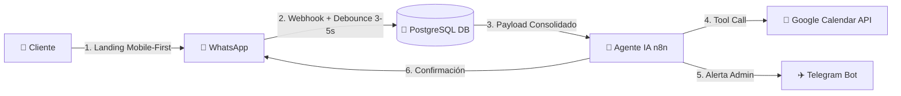

# ¡Hola! Soy Samuel Vargas 👋
### Full-Stack Automator • AI Solutions Architect • Consultor B2B en Automatización

  

  <strong>Diseño y construyo ecosistemas de automatización y agentes de Inteligencia Artificial que generan retorno de inversión medible para empresas y negocios de servicios.</strong>

  
  
  

---

## 💼 ¿Qué problema resuelvo para los negocios?

Los negocios en Latinoamérica pierden hasta el **40% de sus ventas potenciales** por respuestas tardías en WhatsApp, procesos manuales en libretas o Excel, y falta de seguimiento estructurado.

Mi enfoque combina **consultoría comercial estratégica** con **ingeniería de software robusta**:
1. **Agentes de IA en WhatsApp 24/7:** Recepcionistas y cerradores virtuales que atienden en <5 segundos, califican al cliente, cotizan y agendan citas reales.
2. **Arquitecturas sin dependencias frágiles:** Orquestación modular en **n8n**, persistencia transaccional en **PostgreSQL**, y control de costos en tokens.
3. **Embudos Mobile-First de Alta Conversión:** Páginas web ultraligeras con parámetros inteligentes `wa.me` para que el cliente llegue al chat con contexto y alta intención de compra.

---

## 🏆 Proyecto Destacado (Caso de Estudio Estrella)

### 💈 [Sistema Autónomo de Captura y Agendamiento con IA — Andrés Peluquería](https://github.com/Vrydie/Sistema-agendamiento-andres-diaz)
> **Solución B2B llave en mano para salón de belleza de alta gama.**  
> *Stack: Landing Mobile-First (Vanilla CSS/JS) + n8n Modular + PostgreSQL + Google Calendar API + WhatsApp API (YCloud) + Bot de Administración en Telegram.*

- **Impacto:** Eliminación total de citas perdidas por falta de respuesta; reducción drástica de inasistencias (*No-Shows*) gracias a recordatorios automáticos.
- **Arquitectura:** Metodología modular Zero-Monolitos (`DS-01 WebhookIn`, `DS-02 AI Router`, `DS-03 MessageOut`, herramientas aisladas `T-01` a `T-04`).
- 👉 **[Explorar Código y Documentación Completa →](https://github.com/Vrydie/Sistema-agendamiento-andres-diaz)**

---

## 🛠️ Stack Tecnológico & Herramientas

| Área | Tecnologías |
|---|---|
| **Orquestación & Backend** | n8n (Self-hosted & Cloud), Make, Webhooks, REST APIs, Node.js, Python |
| **Inteligencia Artificial** | LangChain, OpenAI (GPT-4o), Google Gemini, Claude, Function Calling / Tool Calling |
| **Bases de Datos & Memoria** | PostgreSQL (Funciones PL/pgSQL, Triggers, Indices), Supabase, Redis, Google Sheets |
| **Mensajería & Canales** | WhatsApp Cloud API, YCloud, Z-API, Telegram Bot API |
| **Frontend de Captura** | HTML5 Semántico, Vanilla CSS (Dark Mode Premium), Vanilla JS, Webhooks |
| **DevOps & Infraestructura** | Docker, Docker Compose, Railway, Render, Cloudflare Tunnels, Git/GitHub |

---

## 📐 Mi Manifiesto de Ingeniería ("Full-Stack Automator")

1. **"El LLM es impredecible, la Base de Datos no":** Jamás delego la lógica de negocio ni la integridad financiera/agendas al modelo de lenguaje. El LLM conversa; PostgreSQL y el código validan y ejecutan.
2. **Zero Monolitos:** Cada flujo tiene una sola responsabilidad. Mantenimiento sin riesgo de romper el sistema entero.
3. **Control de Flujo por Debounce (3–5s):** Agrupación inteligente de mensajes en ráfaga de WhatsApp para ahorrar costos de tokens y ofrecer respuestas naturales.
4. **Auditoría Raw Obligatoria:** Todo webhook entrante se almacena en crudo para trazabilidad y depuración instantánea.
5. **Costo Optimizado ($0 en MVP):** Diseñado para validar rápido sin quemar presupuesto en licencias innecesarias.

---

## 📊 Métricas de GitHub

  
  

---

## 📬 Conectemos

¿Tienes un negocio o una idea de automatización que quieras llevar a producción?
- 💬 **WhatsApp Directo:** [Conversar por WhatsApp](https://wa.me/573154899983?text=Hola%20Samuel,%20quiero%20cotizar%20una%20automatización)
- 💼 **LinkedIn:** [linkedin.com/in/samuel-vargas-acevedo-147219346](www.linkedin.com/in/samuel-vargas-acevedo-147219346)
- 🌐 **Portafolio:** [vrydie.github.io](https://vrydie.github.io)
- 📧 **Email:** [samuel29va@gmail.com](mailto:samuel29va@gmail.com)

---

  Construido con mentalidad de producto, arquitectura limpia y enfoque B2B.

